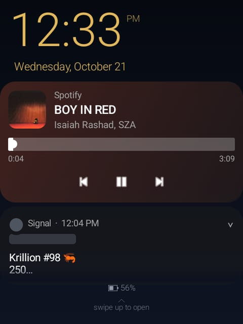
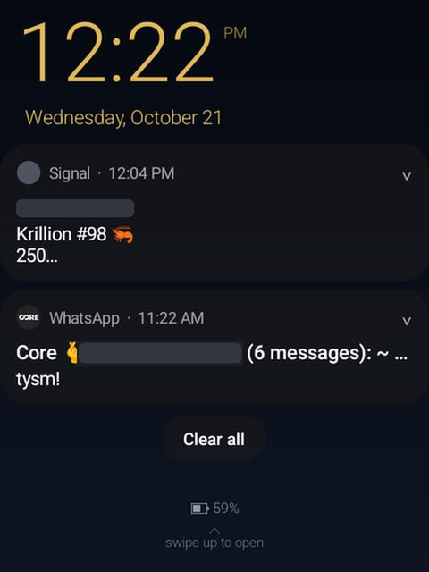
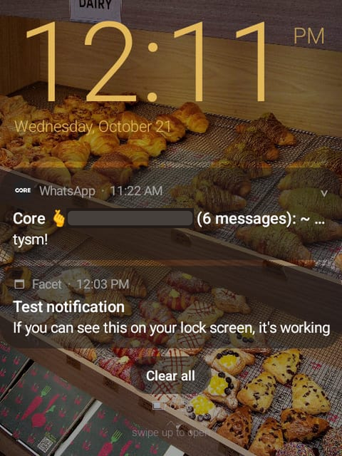
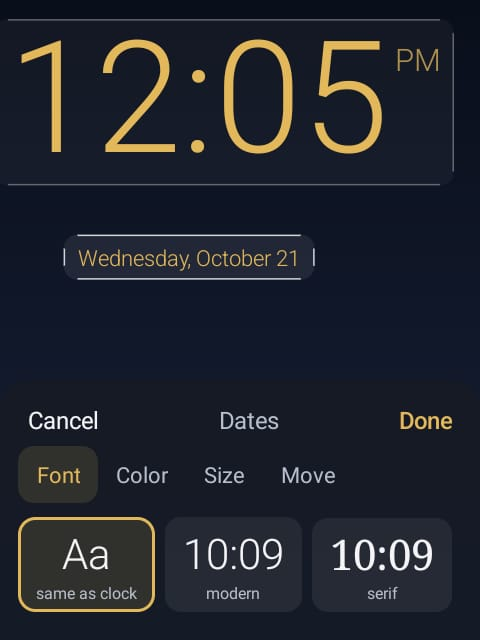
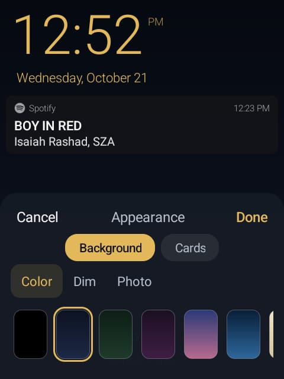
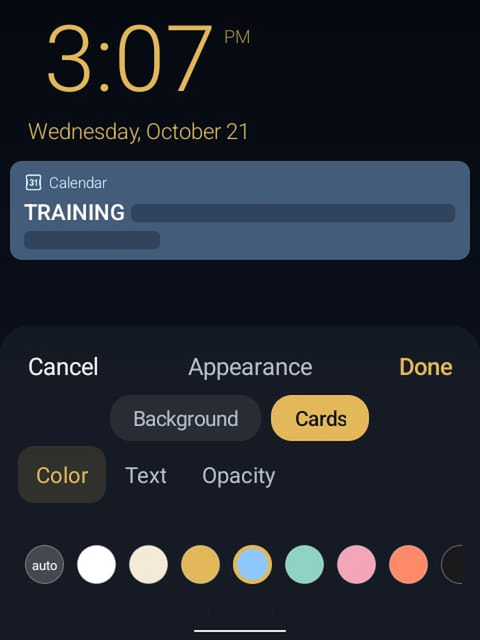

# Facet

A custom lock screen for small Android phones like the Sidephone. Clock, date, notifications and a music player, all laid out to fit a tiny screen, and all editable right on the lock screen.

<p align="center"></p>

## What it does

- **Design your own lock screen.** Hold the clock to move, resize, recolor, or change its font. Hold the date to style it separately. Hold the wallpaper to change the background (color, photo, or dimming) and the notification cards.
- **Notifications that work like stock Android.** Tap a card to preview it, double-tap to open the app, swipe it sideways to dismiss, and use "Clear all" at the bottom.
- **Reply from the lock screen.** Answer messages without unlocking, or mark them as read.
- **One card per conversation,** with contact photos, so chats don't blur together.
- **A music card** with album art, a seek bar, and play, pause, and skip buttons. It works with any music or podcast app.
- **Private.** No internet permission, no ads, no tracking. Nothing leaves your phone. A setting hides message text.
- **Pocket-proof.** The hardware keypad does nothing on the lock screen unless you turn it on, so a phone waking in your pocket won't start anything.

## Screenshots

<p align="center">





</p>

Names and photos in these screenshots are covered for privacy.

## Install

1. Download `Facet.apk` from the [Releases](../../releases) page.
2. Open it and allow "Install unknown apps" for your browser or file manager when asked.
3. Open Facet and follow the two permission steps below.

### Permissions Facet needs

Facet replaces your lock screen, so it needs two special permissions. Android does not allow a normal app to do this without them. Both are in Facet's setup screen, and each has a button that takes you to the right place.

1. **Notification access.** Lets Facet read your notifications so it can show them, and lets it notice when the screen turns off so it can start the lock screen. Facet does not send them anywhere.
2. **Display over other apps.** Lets Facet draw its lock screen on top of everything else.

**If "Notification access" is greyed out:** newer versions of Android restrict this for apps installed outside the Play Store. Go to **Settings > Apps > Facet**, tap the **⋮** menu (top right), choose **Allow restricted settings**, then try again.

Then turn on **Use the custom lock screen** in Facet's settings and lock your phone.

> Facet draws on top of your normal lock screen. It does **not** replace your PIN or fingerprint, so your phone stays as secure as before. Swipe up to reach the normal unlock screen.

### Make sure Facet is actually showing

Facet isn't a real lock screen. Android doesn't let regular apps replace it, so Facet draws itself on top of the lock screen your phone already has. That means a few things have to line up:

1. **Set your phone's own screen lock to Swipe** (Settings > Security > Screen lock). A PIN or pattern also works. Avoid "None", which is not what Facet was tested with.
2. In Facet's settings, turn on **Use the custom lock screen**.
3. Both permissions above must be on. Without Notification access, Facet can't tell when the screen turns off, so it never appears.
4. **Test it:** press the power button to turn the screen off, then press it again. You should see Facet's clock and "swipe up to open". If you see your phone's normal lock screen instead, go back through steps 1 to 3.

Because the normal lock screen is still underneath, swiping up on Facet takes you to it. If you use a PIN or pattern, it asks for it then. If notifications show private text, use Facet's "hide message text" setting.

## Using it

| Do this | To get this |
|---|---|
| Hold the clock | Edit the clock (font, color, size, position) |
| Hold the date | Edit the date |
| Hold the wallpaper | Edit the background and the card colors |
| Tap a notification | Preview it |
| Double-tap a notification | Open the app |
| Swipe a notification sideways | Dismiss it |
| Tap the arrow on a card | Expand it |
| Swipe up (past the last card) | Unlock |

Changes preview live. Press **Done** to keep them or **Cancel** to undo. **Reset all settings** in the app puts everything back how it started.

## Build it yourself

No Gradle needed. On Ubuntu:

```sh
sudo apt install aapt android-sdk-platform-23 dalvik-exchange apksigner zipalign openjdk-17-jdk
./build.sh
```

This produces `Facet.apk`, signed with a key it generates the first time. Keep that key if you want future builds to install over old ones.

## Status

A hobby project, shared as-is. I use it on my own Sidephone and it works for me, but I'm not offering support or planning fixes for other phones. You're welcome to use it, change it, or build on it under the MIT license.
